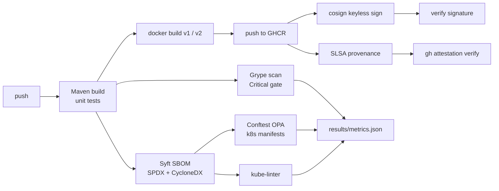

# secure-supply-chain-pipeline

[](https://github.com/youssefbouaouina/secure-supply-chain-pipeline/actions/workflows/ci.yml)
[](LICENSE)


A DevSecOps reference pipeline for a Spring Boot service: SBOM, vulnerability gate, signed
image, SLSA provenance and policy-as-code, with the before/after hardening measured, not
claimed.

## Why

Building an image is easy; proving what is inside it, that it is not vulnerable, that it was
built from this commit, and that it is allowed to run is the hard part. This repo runs the
whole chain in GitHub Actions and records the numbers.

## Pipeline



## The hardening experiment

| | v1 | v2 |
|---|---|---|
| Build | single stage, full JDK | multi-stage, JRE Alpine |
| User | root | dedicated `app` user |
| Base pin | tag + digest | tag + digest |
| Size, CVEs, policy failures | measured | measured |

### Measured result

Run #3 of the workflow, 2026-11-05, from [`results/metrics.json`](results/metrics.json):

| Metric | v1 (before) | v2 (hardened) | Change |
|---|---|---|---|
| Image size | 477.2 MiB | **221.0 MiB** | **-53.7%** |
| Unique CVEs (Grype) | 156 | **65** | -58.3% |
| Critical | 2 | 2 | 0 |
| High | 15 | 23 | +8 |
| Medium | 321 | 42 | -279 |
| Low | 92 | 19 | -73 |
| Findings, all severities | 430 | **86** | -80.0% |
| SBOM packages (Syft) | 201 | 114 | -87 |
| Conftest policy failures | 8 | **0** | -8 |
| kube-linter findings | 8 | **0** | -8 |

The honest reading: the hardened image is less than half the size and carries 80% fewer
findings, but the *High* count went up. The Alpine base brings `sqlite-libs` and `libexpat`,
which account for the eight additional High findings; the Spring application itself has the
same Highs in both images. A smaller base is not automatically a less vulnerable base, and
the table shows that instead of hiding it.

The two Critical findings in v2 are `GHSA-pc63-qcmh-9cmg` and `GHSA-j9f9-w8pj-32f8` in
`spring-webmvc` 6.2.8. Both are marked `not-fixed` by the vulnerability database, so the gate
(`grype app:v2 --fail-on critical --only-fixed`) passes. They are still counted in the table
above. `--only-fixed` is a deliberate policy: fail on a Critical that has a fix, and report
the rest, rather than making the pipeline permanently red for something the project cannot
patch.

Tomcat is pinned to 10.1.59 (the first version on Maven Central that carries the fix), and
the SPDX SBOM confirms `tomcat-embed-core`, `tomcat-embed-el` and `tomcat-embed-websocket`
at that version.

## Evidence in the repository

| File | What it is |
|---|---|
| `results/metrics.json` | machine-readable summary computed from the raw scanner output |
| `results/RESULTS.md` | the same numbers as a report |
| `results/grype-v1.json`, `grype-v2.json` | raw Grype matches (430 and 86) |
| `results/conftest-v1.json`, `conftest-v2.json` | policy results (8 failures and 0) |
| `results/kubelinter-v1.json`, `kubelinter-v2.json` | lint results (8 and 0) |
| `results/cosign_verify.json` | real `cosign verify` output for the pushed digest |
| `results/attestation_verify.txt` | real `gh attestation verify` output |

SBOMs are not committed (the SPDX document is ~6 MB); they are uploaded as the
`supply-chain-results` artifact of each run, and the package counts above come from them.

## Verify the published image

The hardened image is published to GHCR and signed keylessly:

```bash
IMAGE=ghcr.io/youssefbouaouina/secure-supply-chain-pipeline:1.0.0

cosign verify "$IMAGE" \
  --certificate-identity-regexp "https://github.com/youssefbouaouina/secure-supply-chain-pipeline/.github/workflows/ci.yml@refs/heads/main" \
  --certificate-oidc-issuer "https://token.actions.githubusercontent.com"

gh attestation verify "oci://$IMAGE" \
  --repo youssefbouaouina/secure-supply-chain-pipeline
```

## Run locally

```bash
mvn -B verify
docker build -f Dockerfile.v1 -t app:v1 .
docker build -f Dockerfile -t app:v2 .
bash scripts/scan.sh        # needs syft, grype, conftest, kube-linter
```

The scanner versions are pinned in `.github/workflows/ci.yml` (Syft 1.56.0, Grype 0.121.1,
Conftest 0.71.1, kube-linter 0.8.3).

## Limitations

- The application is deliberately tiny; the numbers describe the base images more than the code.
- Grype results depend on the vulnerability database snapshot of the run date.
- The signature and provenance prove origin, not absence of bugs.
- Base-image digests are pinned to the values recorded in `SOURCES.md`; they must be updated
  deliberately.
- Two Critical advisories remain unfixed upstream; see above.

## Sources and licence

See [`SOURCES.md`](SOURCES.md). Code: MIT.

## Author

**Youssef Bouaouina** - [github.com/youssefbouaouina](https://github.com/youssefbouaouina) -
[portfolio](https://youssefbouaouina.github.io/)
