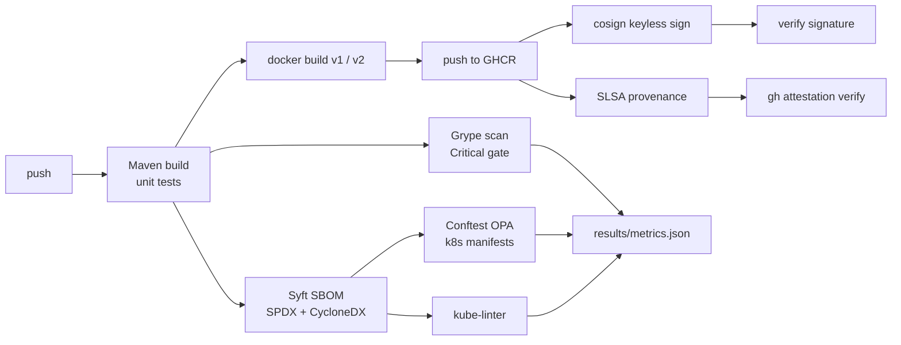

# secure-supply-chain-pipeline

A DevSecOps reference pipeline for a Spring Boot service: SBOM, vulnerability gate, signed
image, SLSA provenance and policy-as-code — with the before/after hardening measured, not claimed.

## Why

Building an image is easy; proving what is inside it, that it is not vulnerable, that it was
built from this commit, and that it is allowed to run is the hard part. This repo runs the whole
chain in GitHub Actions and records the numbers.

## Pipeline



## The hardening experiment

| | v1 | v2 |
|---|---|---|
| Build | single stage, full JDK | multi-stage, JRE Alpine |
| User | root | dedicated `app` user |
| Base pin | tag + digest | tag + digest |
| Size, CVEs, policy failures | measured | measured |

The exact numbers are in [`results/RESULTS.md`](results/RESULTS.md) and
[`results/metrics.json`](results/metrics.json).

## Verify the published image

The hardened image is published to GHCR and signed keylessly. These commands verify it
(real output from the pipeline is in `results/cosign_verify.json` and
`results/attestation_verify.txt`):

```bash
IMAGE=ghcr.io/youssefbouaouina/secure-supply-chain-pipeline:1.0.0

cosign verify "$IMAGE" \
  --certificate-identity-regexp "https://github.com/youssefbouaouina/secure-supply-chain-pipeline/.github/workflows/ci.yml@refs/heads/main" \
  --certificate-oidc-issuer "https://token.actions.githubusercontent.com"

gh attestation verify "oci://$IMAGE" \
  --repo youssefbouaouina/secure-supply-chain-pipeline
```

## Run locally

```bash
mvn -B verify
docker build -f Dockerfile.v1 -t app:v1 .
docker build -f Dockerfile -t app:v2 .
bash scripts/scan.sh        # needs syft, grype, conftest, kube-linter
python scripts/summarize.py
```

## Limitations

- The application is deliberately tiny; the numbers describe the base images more than the code.
- Grype results depend on the vulnerability database snapshot of the run date.
- The signature and provenance prove origin, not absence of bugs.
- Base-image digests are pinned to the values recorded in `SOURCES.md`; they must be updated
  deliberately.

## Sources and licence

See [`SOURCES.md`](SOURCES.md). Code: MIT.

## Author

**Youssef Bouaouina** — [github.com/youssefbouaouina](https://github.com/youssefbouaouina) ·
[portfolio](https://youssefbouaouina.github.io/)

